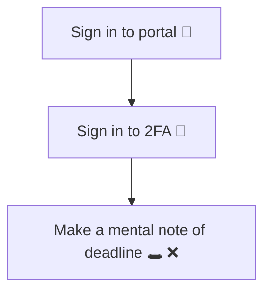
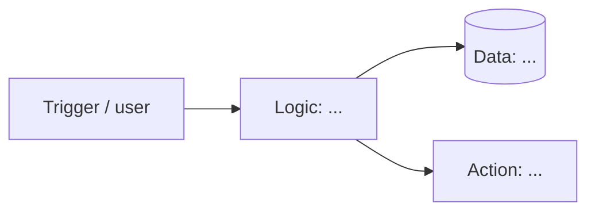
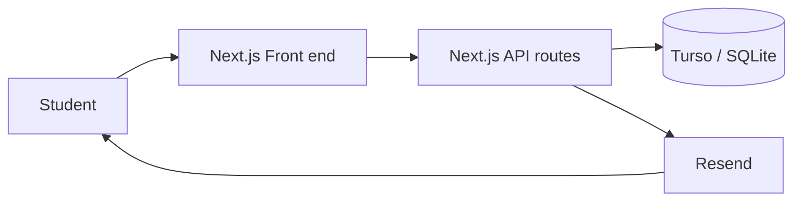

<!--
  Product 2 Spec Template
  Copy everything in this file into the README.md of your Product 2 repository.
  Walkthrough, examples, and AI prompts: https://github.com/464squad/IEL/tree/main/projects/product-2
  Delete these instructions and the italic hints as you fill each section in.
  Privacy: no customer names, contact info, prices/revenue, or anything your partner asked to keep private.
-->

# [Meridian]

> Assignment/Task checker and Reminder for Students

**Partner:** [A fellow Student] · **Partner's role:** [Student]
**Team:** [Romnis Ortiz] · **Course:** CMP 464/343 Product 2 · **Last updated:** [11/25/26]
**Live demo:** [deployment URL, video link, or "see Demo section"]

---

## 1. About the Partner

[They attend a college upstate, and they are trying to improve their time management with scholarly assignments and tasks.]

---

## 2. Discovery Log

### Conversation #1 · [11/22/26] · [in person] · with [Student]
- **Their goals:** Be aware of assignment due dates.
- **How the work happens today:** They check their school portal website and make mental notes of due dates.
- **Pain points** (how often · what it costs): It's very repetitive because they have to sign in AND do 2 factor authentication every time they want to check a deadline.
- **Tools they use now:** The school portal
- **What they've tried / wish existed:** Making mental notes of deadlines.
- **Best quote:** "I don't get email reminders like you do, this sucks."

### Conversation #2 · [date] · …
 *See Feedback*
 
---

## 3. Workflow Map (today)

* 🔴 slow · 🔁 repetitive · ❌ error-prone · 🕳️ falls through the cracks.*

---

## 4. Problem Statement

> **When** [He receives a new assignment or task from his classes],
> **[the Student] struggles to** [manage his deadlines properly or stresses over them too much],
> **which costs them** [time and stress, he usually spends "most of his day" working on an assignment to get it as close to done on the day its assigned in order to meet the deadline].
> **This happens because** [He overstresses because keeping track of multiple deadlines].
> **Right now they** [write it down on his phone's reminders], **but** [he cant check them again and reread them].

**They'll know this is solved when:** [They have something to remind them of deadlines and can reread.]

---

## 5. Existing vs Desired Solutions

| Area | Today (existing) | Desired | Gap |
|---|---|---|---|
|Checking Deadlines | logging into school portal | quickly checking deadlines | logging in to check is repetitive |
|remembering deadlines/assignments | making mental notes | receive a reminder of an assignment/deadline| Mental notes can be forgotten |

**Solution type:** [A webapp that lets you check inputted assignment deadlines and receive emails as reminders for deadlines, to reduce stress and mental load]. 

---

## 6. Features & Benefits

| Feature (what it does) | Benefit for the partner | MVP or Later? |
|---|---|---|
| assignment tracking (ability to input assignment and its details | Keeps all assignments organized in one place instead of relying on mental notes or repeatedly checking the school portal. | MVP |
| Display upcoming, completed, and overdue assignments in an organized, easily accessible view | Allows the student to review their assignments and deadlines whenever they need to. | MVP |
|Automated Email Reminders: Sends email notifications before an assignment's deadline, even when Meridian is closed. | Helps prevent forgotten deadlines and reduces the need to constantly check the school portal | MVP |

**MVP (2–3 features):**

-Assignment tracking

-Assignment display

-Email reminders

**Later:**

-Customizable reminder schedules

-notify if an assignment is past due

**Not doing:**

-Replacing existing school portals

---

## 7. Tech Stack & Architecture

### Surface
- **Surface:** [Web / Mobile / Desktop / CLI / Chat / Automation (+ simple interface)]
- **Why:** *Where and how will your partner (or their customers) use it?*

### Stack
| Piece | Choice | Why |
|---|---|---|
| Front end / interface |Next.js + React | works on phone and computer |
| Back end / automation logic | Next.js API routes | Can send emails and handle logic in the same project |
| Data | SQLite (via Turso) | Stores assignments online so reminders work even when the app is closed |
| Outside services / APIs | Resend | Sends the email reminders |
| Hosting / where it runs | Vercel | Deploys the site and runs the API routes |

### Architecture
*Show how a trigger or request flows through the system.*

flowchart LR
  U[Student] --> FE[Next.js Front end]
  FE --> API[Next.js API routes]
  API --> DB[(Turso / SQLite)]
  API --> Email[Resend]
  Email --> U

---

## 8. Solution Brief (for your partner)

*One page, written in **plain language**: no tech jargon. You should be able to hand this to your partner.*

**The problem we heard:** [1–2 sentences, in their words]

**What we're building:** [1–2 sentences]

**How it will help:** [time saved, money saved, fewer mistakes]

**What you'll need to do:** [e.g. "fill out a form when a customer books" / "nothing, it runs automatically"]

**What it won't do (yet):** [scope limits]

---

## 9. Demo

*Screenshots, a GIF, a video (under 2 min), or a live link. For automations, show the whole flow from trigger to result.*

---

## 10. Partner Feedback

**Date and format:** [in person / video call]

- "Quote 1"
- "Quote 2"

**What worked:**
**What didn't / was confusing:**
**What they'd want next:**

---

## 11. Team *(pairs only)*

| Teammate | What I did (discovery, features, files) |
|---|---|
| | |

---

## 12. What We Learned

*What you didn't know at first, how you figured it out (which tools, tutorials and AI), where the AI got it wrong, and what you'd do differently.*
